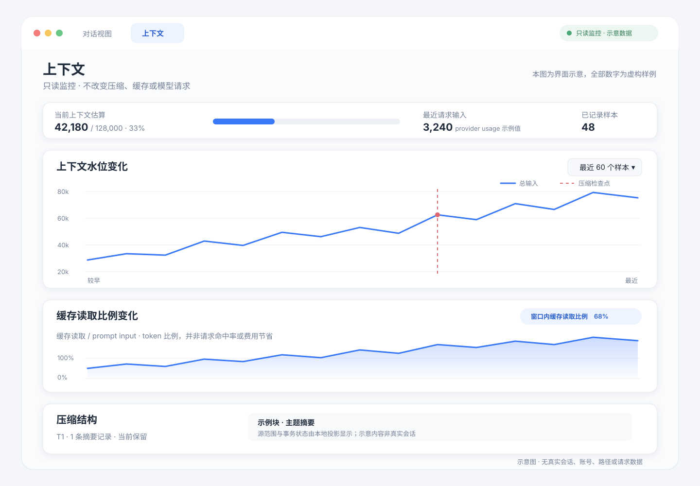

# 上下文监控 / DSH context monitor

独立插件 **`@local/dsh-context-monitor 0.1.6`**。DSH 声明范围 **`>=0.2.2-rc.1 <0.2.3-0`**；`billion-context-dsh v0.2.272` 是可选观察对象，不是运行依赖。

## DSH 版本兼容性

**DSH 0.2.2-rc.3 与 rc.5 均经过本机实测。** rc.5 上本监控插件的只读投影和界面路径运行正常。rc.1 / rc.2 仅做源码静态核对，未运行实测；rc.4 及同一版本线后续 RC／正式版仍未经实测。另一次在 rc.5 上的真实上下文压缩由可选后端 **billion-context-dsh** 执行，并非本监控插件的能力。本插件只观察用量／上下文投影及可选 ACP 状态／元数据，不执行压缩、解压或搜索。详细范围见 [docs/COMPATIBILITY.md](docs/COMPATIBILITY.md)。

不纳入 0.2.1 及更早、0.2.2 alpha/beta、0.2.3（含预发布）及更高版本。较旧的投影 API 不支持 `wire.summary: false`，会将本插件的大块监控数据带入会话列表摘要；不是简单放宽范围就能安全支持。完整版本矩阵、证据链接、降级行为见 [docs/COMPATIBILITY.md](docs/COMPATIBILITY.md)。本声明只针对监控插件，不覆盖被监测压缩后端自身的版本要求。

## 用法与功能

安装并刷新现有 DSH 页面后，在会话顶部与聊天等并列的标签中选择 **上下文 / Context**。

### 安装

在 DSH 的插件管理器中添加以下 GitHub 源（已包含前端产物，无需构建脚本）：

```text
github:NekogamiJam/dsh-context-monitor#v0.1.6
```

也可从 [GitHub Releases](https://github.com/NekogamiJam/dsh-context-monitor/releases) 选择预打包 `.tgz`。包名保留 `@local/dsh-context-monitor` 以兼容既有本地安装；`private: true` 仅阻止意外 npm 发布，不妨碍 GitHub 或 tarball 安装。未发布 npm。


- 概览：宿主累计输入、缓存读取和输出，监控投影记录的 usage 样本数。
- 水位：DSH `contextPressure.projectedTokens` 本地投影估算、窗口容量、最近已结算请求的真实 usage 输入。
- 趋势：总输入蓝线、缓存读取半透明蓝色面积、已提交的原生压缩检查点标记、缓存读取 token 比例；**默认最近 600 个样本**，也可选最近 60 / 180 个样本。
- 压缩结构：T1/T2/T3、持久 compaction ID、billion-context-dsh bN 引用、来源块关系、源 seq、替换规模、摘要粗估、事务和表层状态；支持主题／引用筛选。
- 安全降级：billion-context-dsh 不存在或未启用时继续显示通用 DSH 指标；inventory 失败显示未知；监控投影缺失显示提示，不影响聊天。

### 界面示意



> 这是按当前界面布局绘制的静态示意图，并非用户会话截图；图中数值、趋势线、检查点与压缩记录均为虚构内容，不含账号、路径、会话标识或真实请求数据。

这里只展示脱离正文的少量元数据，不提供压缩／解压按钮，不调用 provider，不读取旧 bili 数据库，不向 system prompt 注入任何内容。没有改动 billion-context-dsh、旧 bili 或 DSH 本体。

## 指标口径（重要）

DSH 0.2.2-rc.3 / rc.5 的 TokenUsage 是互斥桶：

```
prompt input = inputTokens（未缓存）+ cacheReadTokens + cacheWriteTokens
cache-read share = cacheReadTokens / prompt input
```

- 累计桶直接订阅宿主 `tokenUsage`，包括该投影处理的重试与继承历史；**不是当前 fork 子会话的独立账单**。
- 图表记录显式 `assistant/message.data.usage`。未上报 read 的样本留空，不伪装成 0%；usage 只在失败 attempt stream 中的请求不会出现在图表。因此样本数不是全部 HTTP 请求数。
- 当前水位为宿主估算，最近请求输入为 provider reported；请求进行中保留上一已结算值。窗口容量与压力是独立时间点，不保证原子配对。
- 缓存读取比例不是“多少请求命中”、价格折扣、实际节省金额或 KV 驻留率。
- `shadowedTokenCount` 是宿主／插件的日志计价；摘要按文本字符数 / 4 粗估。它们都不等同于 provider 实测。多层压缩存在重叠，不累计成“节省 token”。
- 无法可靠归因缓存失效是 TTL、压缩还是模型切换，不仿造截图中的 Cache economics／Ledger balanced。
- 原始记录仍在 DSH 会话日志；此插件不打开或迁移旧代理状态。

## 数据与上限

Host 通过 `ctx.sessionProjections.register()` 注册 `localContextMonitor`，使用纯同步 fold，JSON state、版本 1、Zod 严格 schema、`summary: false`（不增加会话列表摘要流量）。Client 在 `conversation.view` session slot 使用 `props.useProjection`，不重复扫描会话正文或轮询事件。

每会话最多保留 **600 个样本、400 个摘要记录**。超过后页面明确提示不完整；全部事件仍在原始日志，重放结果有相同上限。不会把未知元数据或缺少精确 sourceEventSeqs 的表层关系猜成确定结果。

billion-context-dsh 当前启用状态仅通过公开 `pluginInventory/list` 的精确模块名、enabled 和 active phase 判断；页面进入和“重新检测”时读取快照，不根据历史块或构造函数名认定 active。缺少该 Remote 时显示未知。

## 本地开发

```powershell
npm install --ignore-scripts --no-audit --no-fund
npm test
npm run check
```

生产依赖仅固定版本 `zod 4.6.6`，与已运行验证的宿主版本一致；开发测试另用 `semver 7.8.5` 校验预发布范围。无构建脚本、无强制 peer 安装或版本豁免。`client.js` 是 DSH ModuleLoader lazy factory，React 从宿主表获取，无第二份 React、CDN 或 iframe。

通过插件管理器安装此目录（不在 profile 手工运行 npm/pnpm）。这是一个 additive bundle，只新增 `local-context-monitor`，不覆盖任何出厂、billion-context-dsh 或 bili 条目。初次安装可以 HMR 激活，但仍需刷新既有页面加载 Client；替换已加载版本应按宿主结果重启，不承诺修改文件自动热更新。

卸载／回退：在插件管理器停用或删除 **上下文监控** bundle 即可，不必停用 billion-context-dsh；不改写任何会话历史。开发目录安装后被 profile 链接引用，**不要移动或删除该目录**。

## 验证状态

实现／测试／安装记录见 [docs/VERIFICATION.md](docs/VERIFICATION.md)。截至编写初稿，尚未宣称视觉验收或 fork 首请求问题修复。本监控插件也不是旧代理迁移器；不能拿面板中的块数作为成本故障已经修复的证明。

界面参考用户提供的 billion-context 仪表盘布局，但未复制其源码、截图或第三方品牌标识。README 中的界面示意为原创 SVG，所有数据虚构；图标是原创轻量折线图 SVG。插件管理器无单独详情配图，按 README 回退展示使用说明。
